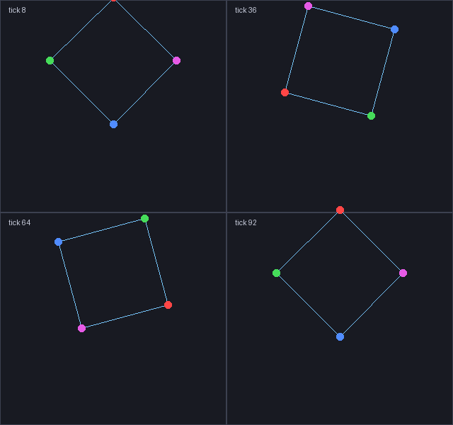

# rot_polygon

生成**旋转正多边形 / 矩形**的 Rizline 谱面引导线。给一个边数、半径、播放流速，产出一份
可直接丢进编辑器的谱面 JSON：图形绕固定圆心匀速旋转，边用跨画布的线相连。

> 本仓库只含源码与文档：不含第三方库、不含美术/音乐素材、不含构建产物。



## 它做什么

```text
n 个顶点 —— 每个顶点一个画布，画布沿外接圆做 x + 速度的三角函数运动
边      —— 一条跨画布的线，两端各挂在自己顶点的画布上
```

因为顶点共圆、相位差 360°/n，任何时刻都是标准正 n 边形；矩形（宽≠高）的四角在圆上不等距，
程序按 `atan(H/W)` 处理。

## 快速开始

```powershell
# 需要 Python 3.10+，并把谱面库放到相邻目录（见下）
python rot_polygon.py --sides 4 --radius 2 --flow 3.5 --out 正方形.json
python rot_polygon.py --sides 6 --radius 1.5 --flow 3.5 --rev 21 --out 六边形.json
python rot_polygon.py --interactive            # 问答式
```

产物里每个顶点一个画布（默认 1 号起），节点错开到不同拍方便在编辑器里选中，判定环全透明。

## 依赖：rizChartFunction_Library（不在本仓库）

谱面的读写、`floorPosition` 计算都依赖
**[rizChartFunction_Library](https://github.com/xp00000002/rizChartFunction_Library)**（第三方项目，
有自己的许可，因此不随本仓库分发）。

```powershell
# 放到本工具旁边，程序会自动找到
git clone --depth 1 https://github.com/xp00000002/rizChartFunction_Library.git ..\rizChartFunction_Library
# 或者克隆到任意位置，用环境变量指定
$env:RIZCHARTFUNCTION_SRC = 'D:\libs\rizChartFunction_Library\src'
```

查找顺序：`RIZCHARTFUNCTION_SRC` → 工具同级的 `rizChartFunction_Library\src` → 上一级 → 当前目录。

## 参数（常用）

| 参数 | 说明 |
| --- | --- |
| `--sides` / `--radius` | 边数（≥3）/ 外接圆半径（世界单位；一屏高 = 6.9） |
| `--width` `--height` | 矩形宽高（仅 `--sides 4`） |
| `--flow` | **必须**等于编辑器里的播放流速（`S1 = 7(S0−1)/9+6`） |
| `--start` / `--end` | 旋转起止拍（默认 8 / 92） |
| `--rev` | 转一圈几拍（0 = 整段一圈） |
| `--step` | 采样间隔（拍，默认 0.5） |
| `--center-y` | 圆心高度（世界单位，默认 3.2 ≈ 半屏） |
| `--colors` / `--color` | 顶点调色板 / 统一色（边两端不同色会自动渐变） |
| `--into` / `--canvas-start` | 追加到已有谱面，从指定画布开始 |
| `--stagger` | 相邻顶点错开的拍数（默认 0.25，方便选中） |

完整说明见 [`docs/manual.md`](docs/manual.md)。

## 测试

```powershell
python -m unittest discover -s tests      # 14 个
```

## 许可

本仓库的**代码与文档**采用 [MIT License](LICENSE)。
第三方声明：`rizChartFunction_Library` 不属于本仓库；示例谱面由本工具生成，不含第三方素材。
